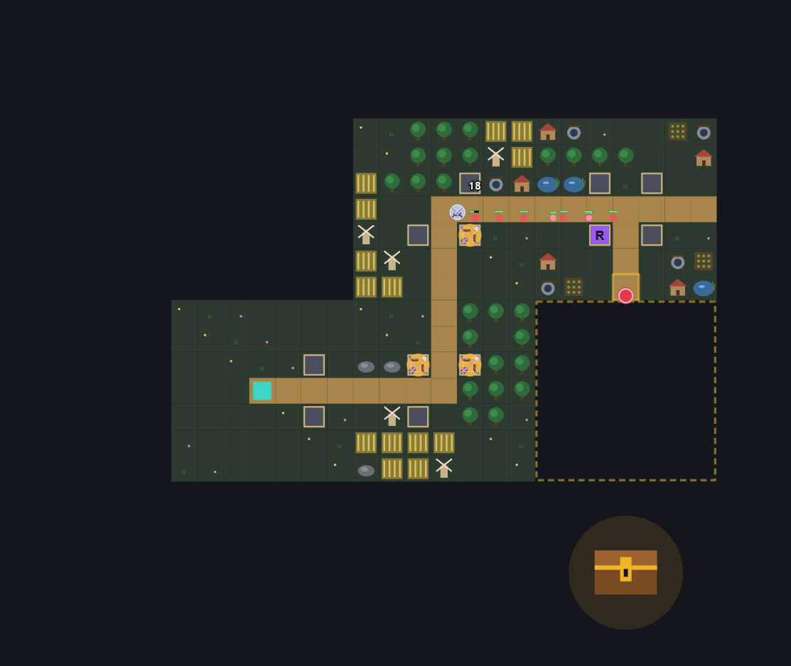

# 🏰 Towerize

**Expande. Mejora. Resiste.**

Towerize es un *tower defense* con elementos *roguelike* para navegador. En cada partida construyes el mapa pieza a pieza mientras defiendes un núcleo de oleadas de enemigos cada vez más duras. Ninguna partida es igual a la anterior.

### ▶ [Jugar ahora](https://jdnogal.github.io/towerize/)

Funciona en el navegador, tanto en ordenador como en móvil (en horizontal). No hace falta instalar nada.




> 🚧 **En desarrollo.** El juego está en evolución constante y algunas partes pueden cambiar.

---

## 🎮 Cómo se juega

Cada ronda tiene tres fases:

1. **Colocar una pieza.** Eliges una de tres piezas de mapa, la giras y la conectas al camino. Así el mapa crece y se abren nuevos portales por los que llegan los enemigos.
2. **Construir.** Levantas torres en los solares junto al camino, las mejoras y colocas a tu héroe.
3. **Resistir la oleada.** Los enemigos salen de los portales hacia tu núcleo. Si llegan, pierdes vida.

Gana la partida quien sobreviva hasta el jefe final y lo derrote.

## ✨ Características

- **Mapa generado por piezas.** Rectas, curvas, bifurcaciones y cruces: cada decisión cambia por dónde llegan los enemigos.
- **Héroes con habilidades.** Cada héroe tiene su estilo, su reliquia inicial y un mazo de torres propio. Suben de nivel durante la partida y desbloquean habilidades.
- **Torres con especializaciones.** Las torres suben hasta nivel 3, y en el nivel 4 eliges entre dos especializaciones con habilidades propias.
- **Combate con profundidad.** Daño físico, mágico y elemental; armaduras; y estados como quemadura, veneno, sangrado o congelación.
- **Casillas especiales.** Algunas piezas traen casillas que potencian la torre que se construya encima.
- **Reliquias, cofres y eventos.** Reliquias con efecto pasivo y activo, y eventos con decisiones que pueden cambiar la partida.
- **Progreso entre partidas.** Logros que desbloquean héroes, torres y reliquias, y un compendio con todo lo que vas descubriendo.
- **Historia.** Una pequeña trama que avanza al ganar partidas.
- **Tutoriales y pistas.** Un tutorial completo, otro rápido y pistas que aparecen la primera vez que ves algo nuevo.
- **Opciones de accesibilidad.** Velocidad de juego ajustable, pausa, números de daño configurables y opciones de lectura.

## 🕹️ Controles

| Acción | Ordenador | Móvil |
|---|---|---|
| Seleccionar / construir | Clic | Toque |
| Girar pieza | `R` o botón de girar | Botón de girar |
| Mover el mapa | Arrastrar | Arrastrar con un dedo |
| Zoom | Rueda del ratón | Pellizcar con dos dedos |
| Ver información | Mantener el ratón encima | Botón de lupa 🔍 |
| Vender torre | Clic derecho | Desde el panel de la torre |
| Cancelar acción | `Esc` | Volver a pulsar el botón |

## 🛠️ Tecnologías

- **JavaScript puro, HTML5 y CSS3**, sin frameworks ni librerías externas.
- **Canvas 2D** para el renderizado del juego, y **SVG** para los retratos de los héroes.
- **Búsqueda de caminos (BFS)** para el movimiento de los enemigos.
- **localStorage** para guardar el progreso, los logros y las opciones.
- **Pointer, Touch, Fullscreen y Screen Orientation APIs** para la versión móvil.
- **Un único archivo HTML** autocontenido: no necesita compilación ni servidor.

## 🤖 Desarrollo asistido por IA

Towerize se ha desarrollado con ayuda de **Claude Code** como asistente de programación, a lo largo de más de 200 iteraciones. La IA se ha usado para acelerar la implementación, refactorizar y explorar ideas. El diseño del juego, las mecánicas y las decisiones finales son propias.

## 🚀 Ejecutarlo en local

```bash
git clone https://github.com/JDNogal/towerize.git
```

Después basta con abrir `index.html` en el navegador.

## 👤 Autor

**Javier del Nogal González** · Desarrollador Full Stack

[LinkedIn](https://www.linkedin.com/in/javier-nogal-glez/) · [GitHub](https://github.com/JDNogal)
